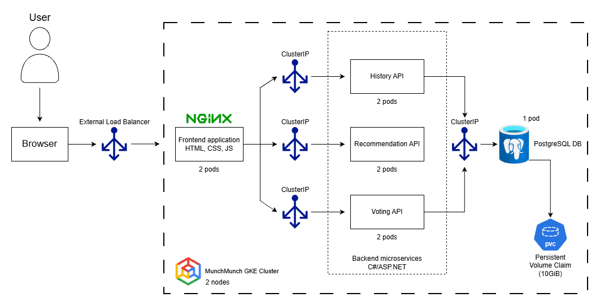

# MunchMunch

MunchMunch is a web application hosted on cloud infrastructure, designed to help users 
decide what to eat through randomised food recommendations.

The motivation behind this project stems from my personal experience of frequently 
struggling to decide what to eat. Despite feeling hungry, I often find myself without any 
particular cravings or preferences, making the process of choosing a meal unnecessarily 
difficult. According to Google Trends data analysed through Glimpse, the keywords “lunch 
ideas” and “dinner ideas” generated approximately 260,000 searches in Australia over the 
past month. Recognising that many others experience similar difficulties 
when deciding what to eat and identifying a lack of compelling existing web applications 
solving this issue, I saw significant potential in developing MunchMunch.

## Web Preview
==will be inserted soon==

## Tech Stack

**Backend**

- C# / .NET 8
- ASP.NET Core Web API (Minimal APIs)
- PostgreSQL

**Frontend**

- HTML / CSS / JavaScript
- Asynchronous API requests (Fetch API)

**Cloud & Infrastructure**

- Docker / Docker Compose
- Nginx (web serving and reverse proxy)
- Kubernetes
- Google Kubernetes Engine

## Architecture & Data Flow

## Deployment & Kubernetes Testing
- Deployment instructions to GKE are in DEPLOYMENT.md
- Kubernetes demonstration commands are in KUBERNETES_DEMO.md